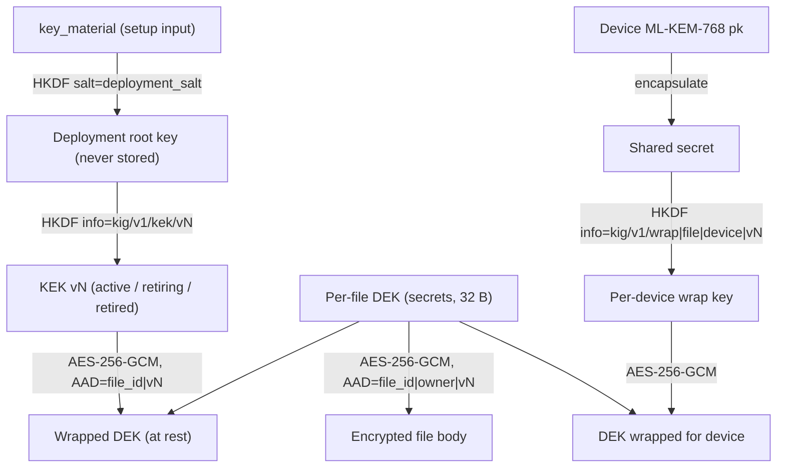
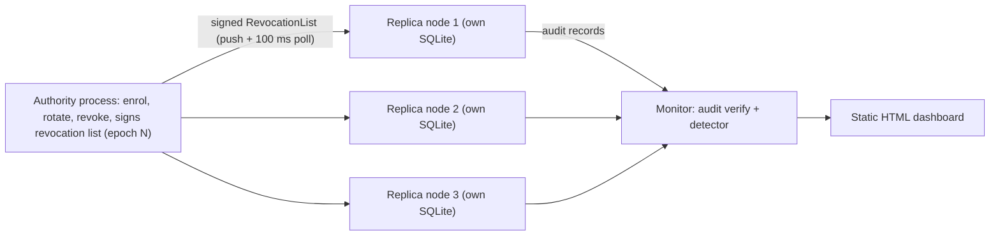

# Key Identity Guard: Tech Stack (v2)

This replaces the **Tech stack** section of [FEATURES.md](FEATURES.md). It combines the original plan, the review feedback, and checks run on the dev machine.

> [!IMPORTANT]
> **The design rule:** the judging runtime is Python 3.12 with the standard library plus `pqcrypto==0.4.0` and **nothing else**. The interface defined by the toolkit's `adapter-v1.md` and `validate.py` is the source of truth. The internal design serves that interface, not the other way round.

---

## 0. Assumptions to verify (before writing code)

| # | Assumption | How to verify | If it's wrong |
|---|---|---|---|
| V1 | Judging runs offline in `python:3.12` with only `pqcrypto==0.4.0` installed | Track-4-Toolkit README / `validate.py` | Rebuild the dependency list |
| V2 | One JSON request per process; state lives only in `TRACK4_STATE_DIR` | `adapter-v1.md` | Change the adapter design |
| V3 | The container's Python links OpenSSL 3 `libcrypto` (it does in the official images) | `python -c "import ssl; print(ssl.OPENSSL_VERSION)"` inside the container | Use the vendored fallback AEAD (section 3.2) |
| V4 | Organizers accept a native AES-GCM reached through `ctypes` | Ask in the organizer channel | Use the vendored fallback and state the limit |

**Dev machine (checked 2026-11-26):** Python 3.12.10, OpenSSL 3.0.16, `libcrypto-3.dll` present in `Python312\DLLs`, Docker 29.3.1. `pqcrypto` is **not installed yet** (`pip install pqcrypto==0.4.0`).

---

## 1. Runtime stack (what the judges run)

| Layer | Technology | Used for |
|---|---|---|
| Language | **Python 3.12**, standard library | Everything |
| PQ key encapsulation | `pqcrypto.kem.ml_kem_768` (FIPS 203) | Wrapping data keys per device, `protected_read` proofs, messaging handshake |
| PQ signatures | `pqcrypto.sign.ml_dsa_65` (FIPS 204) | Device requests, revocation lists, audit checkpoints, backup manifests, handshake transcripts |
| Symmetric AEAD | **AES-256-GCM**: OpenSSL `libcrypto` through `ctypes` (primary), vendored pure-Python `tlslite-ng` (fallback) | Files at rest, wrapped data keys, message encryption |
| Hash / MAC | `hashlib.sha256`, `hmac`, `hmac.compare_digest` | Hash chain, manifests, `protected_read` proof, constant-time comparisons |
| KDF | HKDF-SHA-256 (RFC 5869) built on stdlib `hmac`, tested against RFC 5869 vectors | Every derived key |
| Randomness | `secrets` (OS CSPRNG) | Data keys, nonces, salts, IDs, challenges |
| Persistence | `sqlite3`: one database per node, `journal_mode=WAL`, `synchronous=FULL` | Keys, devices, revocations, rotation steps, audit log |
| Node transport (demo) | `http.server.ThreadingHTTPServer` + `urllib.request` on `127.0.0.1` | Revocation push/pull, health, latency measurement |
| Processes | `subprocess` / `multiprocessing` | 3 replica nodes + authority + monitor |
| Serialization | `json` (canonical form: `sort_keys=True`, `separators=(",",":")`, `ensure_ascii=True`) | Requests, records, signed payloads |
| Detector | `dataclasses`, `heapq`, `collections`, `statistics`, `datetime` | Rules, service graph, reorder buffer, metrics |
| CLI | `argparse` | `kig` commands |
| Dashboard | `string.Template` writes one static HTML file (inline CSS/JS, no CDN) | Operator view |
| Tests | `unittest` + the toolkit's `validate.py` | Unit, integration, attack and contract tests |
| Metrics | `time.perf_counter_ns`, `tracemalloc`, `statistics.quantiles` | p50/p95 latency, memory, size overhead |

**`requirements.txt`** (runtime): `pqcrypto==0.4.0`
**`requirements-dev.txt`**: `ruff`, `mypy` (never imported by runtime code)

---

## 2. Algorithms and sizes

| Purpose | Algorithm | Sizes (bytes) |
|---|---|---|
| Key exchange | ML-KEM-768 | pk 1184 · sk 2400 · ct 1088 · ss 32 |
| Signatures | ML-DSA-65 | pk 1952 · sk 4032 · sig 3309 |
| AEAD | AES-256-GCM | key 32 · nonce 12 · tag 16 |
| KDF | HKDF-SHA-256 | output 32 |
| Hash chain | SHA-256 | 32 |

- Every HKDF call uses a unique `info` label, e.g. `kig/v1/kek`, `kig/v1/wrap|{file_id}|{device_id}|{ver}`, `kig/v1/msg|{session_id}`.
- **SPHINCS+ is not used.** `pqcrypto` 0.4.0 ships round-3 SPHINCS+, which is *not* FIPS 205 SLH-DSA. ML-DSA-65 covers every signing need.
- **No hybrid X25519 + ML-KEM.** X25519 isn't in the standard library, so this is listed as future work.

---

## 3. Symmetric encryption decision

### 3.1 Primary: OpenSSL AES-256-GCM through `ctypes`
- Python's own `_hashlib` and `_ssl` modules already link OpenSSL 3 `libcrypto`, so it's present wherever Python is. We call the vetted, native, constant-time (AES-NI) implementation through the `EVP_*` API. **We write a binding, not a cipher.**
- Finding the library:
  - Linux: the `libcrypto.so.3` path from `/proc/self/maps` after `import _hashlib`, falling back to `ctypes.util.find_library("crypto")`
  - Windows: `sys.base_prefix\DLLs\libcrypto-3.dll`
- **Startup self-test (required):** NIST GCM test vectors, plus a negative test (a flipped tag must fail). If any check fails, the provider is disabled.
- Binding rules: set the IV length explicitly, set the tag before `DecryptFinal_ex`, treat any return value ≠ 1 as failure, never return plaintext before the tag is verified, and free the context in `finally`.

### 3.2 Fallback: vendored pure-Python AES-256-GCM (`tlslite-ng`)
- Copied into `kig/vendor/tlslite_aesgcm/` with the original LGPL-2.1 licence and a credit notice. Not modified.
- **Same algorithm and same output format**, so data encrypted by one implementation can be read by the other.
- The provider in use is recorded in `setup` output and in audit records (`aead_impl: openssl|purepy`). The fallback is labelled **"prototype only, not constant-time"** in the threat model.

### 3.3 If both fail
Fail closed: refuse to store or serve protected content and return a fixed error code. Never write plaintext to disk.

> [!WARNING]
> Passing test vectors proves the output is correct, **not** that the code resists side-channel attacks. The brief must say this plainly.

---

## 4. Key hierarchy



- **Revoking a device** deletes its per-device DEK wrap and adds the device to the signed revocation list. Wraps for other devices and users are untouched.
- **Re-enrolling** registers a new device keypair (signed by the owner's identity) and re-wraps the DEK for it.
- **Rotating** creates KEK v(N+1), re-wraps every DEK, then moves vN to `retiring` (grace window, default **30 s**, documented) and then to `retired` (rejected by every node).
- **Authorization is separate from crypto.** ML-KEM only sets up a key. Whether a request is allowed is decided by the identity layer: an ML-DSA signature from the device, a device status check, and owner policy.

---

## 5. Nodes and process layout



- **Three identical replica nodes.** Each one serves reads and enforces revocation **on its own**, so "every node rejects" (goals 1 and 2) is a real, measurable claim.
- **RevocationList** = `{epoch, revoked_devices[], revoked_identities[], kek_min_version, cutoff_ts}`, signed with ML-DSA-65. A node rejects a list whose epoch is lower than its own (rollback protection) and keeps enforcing its last good list if the authority can't be reached.
- **Propagation latency** = authority `revoked_at` → last node's `enforced_at` acknowledgement (same host clock, in ms). Reported by `kig bench`.
- **Stage 1 adapter:** each request runs as a single process with no long-running servers. "Nodes" there are separate databases inside `TRACK4_STATE_DIR`, and the revocation list is applied synchronously, so the contract is never affected by network timing.

---

## 6. Persistence (`sqlite3`)

- Pragmas: `journal_mode=WAL`, `synchronous=FULL`, `foreign_keys=ON`, `busy_timeout=5000`.
- **All state changes run inside sqlite transactions.** This replaces the temp-file + `fsync` + rename approach, so there's only one persistence mechanism.
- Crash-safe rotation: a `rotation_wal` table records `PREPARE → REWRAP(n/m) → COMMIT`. On startup, an unfinished rotation is rolled **forward** if REWRAP finished, otherwise **back**. Revocations sit in a separate table that rotation never touches.
- On open, `PRAGMA quick_check` runs. A corrupt or missing database **fails closed** (deny plus a fixed error code).
- IDs are opaque and only used as bound parameters, never as file paths (prevents path traversal).
- Main tables: `identities`, `devices`, `kek_versions`, `files`, `dek_wraps`, `revocations`, `rotation_wal`, `audit_log`, `checkpoints`, `replay_cache`, `tickets`.

---

## 7. Tamper-evident audit log

- **Record:** canonical JSON with `ensure_ascii=True`, so newlines and control characters in user text are always escaped and can't create a fake second record or change the actor. On export, each record is **length-prefixed** (`<len>\n<json>\n`).
- **Chain:** `hash_i = SHA256(hash_{i-1} || canonical_i)`, with a fixed genesis value per deployment.
- **Checkpoints:** every 64 records and at the end of each command, `{seq, hash, ts}` is signed with the audit ML-DSA-65 key.
- **`kig verify-log`** works offline with only the audit public key. It reports the first broken `seq` and classifies the problem as `edit | delete | reorder | truncate | bad_signature`.
- **Fields in every decision record:** `request_id, actor, device, asset, action, decision, rule, kek_version, node_id, aead_impl, ts_raw, ts_corrected`.

---

## 8. Detector (explainable, no ML)

| Component | Implementation |
|---|---|
| Ingest | Parses events into `dataclass` objects, keeps the raw timestamp and source |
| Clock handling | Corrected time = raw + offset per source; reorder buffer (`heapq`) with a watermark; supported offset **±5 s**, max lateness **10 s**. Events closer together than the uncertainty margin are tagged `order_uncertain` |
| Approved changes | Exact match on subject + role + scope + `valid_from ≤ t < valid_until` from `approvals.json` |
| Privilege rule | Role increase with no approval → HIGH alert; links later accesses in the same session |
| Lateral movement | Baseline adjacency set of service edges; alert when **N ≥ 3** new edges appear for the same actor + session within the window; one isolated denial doesn't alert; says whether requests were denied or succeeded |
| Revocation self-monitoring | Use of a revoked device/identity or a retired KEK → alert (counts as "detect and respond") |
| Alert format | `{alert_id, rule_id, severity, identity, services, path, event_ids, reason, order_uncertain}` |
| Benchmark | Seeded generator (`random.Random(seed)`) → labelled log → **F1, median time to alert, false alerts per 1,000 benign events**, plus the toolkit practice set |

---

## 9. PQ end-to-end messaging

| Part | Design |
|---|---|
| Handshake | Initiator sends a new temporary ML-KEM-768 public key, signed with its ML-DSA-65 identity key. Responder encapsulates and signs the transcript. Session keys = HKDF(ss, transcript hash) |
| Encryption | AES-256-GCM. Nonce = 4-byte per-direction prefix ‖ 8-byte sequence number (never reused) |
| Recipient binding | AAD = `sender ‖ recipient ‖ session_id ‖ seq ‖ msg_id`, so changing the recipient makes the tag check fail |
| Replay | 64-message sliding window (bitmap) + seen `msg_id` set, stored per session in `replay_cache` |
| Forward secrecy | Temporary KEM private key and session keys are held in a `bytearray`, zeroed and dropped on close. A test leaks the long-term key afterwards and shows old sessions stay unreadable |
| Loss/reordering | Seeded lossy transport simulator; chunks are reassembled with a timeout and bounded retries; incomplete messages are discarded and reported |
| Resumption | Ticket encrypted under a node ticket key and bound to SHA-256(peer identity pk); 5 min lifetime; revocation re-checked on resume. The same `session_id` from a different identity is rejected |
| Revoked device | Can't complete a handshake or resume a session |

---

## 10. Entry points and repository layout

```
devforge/
├── track4_service.py          # Stage 1 adapter (one JSON request -> one JSON response)
├── threat-model.json
├── demo.py                    # narrated lost-device story, PASS/FAIL per step
├── requirements.txt           # pqcrypto==0.4.0
├── requirements-dev.txt       # ruff, mypy
├── kig/
│   ├── __main__.py            # `python -m kig <cmd>`
│   ├── crypto/                # pq.py, hkdf.py, aead.py (provider select + self-test)
│   ├── vendor/tlslite_aesgcm/ # LGPL, credited, unmodified
│   ├── identity/              # enrolment, policy, authorization decisions
│   ├── keys/                  # KEK/DEK, rotation WAL, backup/restore
│   ├── nodes/                 # replica, authority, revocation list
│   ├── audit/                 # records, chain, checkpoints, verify
│   ├── detect/                # ingest, clock, rules, graph, bench
│   ├── messaging/             # handshake, channel, transport sim, tickets
│   ├── store.py               # sqlite helpers, pragmas, migrations
│   └── dashboard/             # template.html + generator
├── tests/                     # unittest: one file per goal + attack tests
├── scripts/                   # verify.ps1, verify.sh, bench runner
└── docs/                      # ps.md, FEATURES.md, TECH_STACK.md, evidence-sheet.md, brief/
```

**CLI:** `python -m kig {demo|enrol|rotate|revoke|backup|restore|verify-log|detect|bench|dashboard}`

---

## 11. Dev and delivery tools (judges never run these)

| Tool | Purpose |
|---|---|
| **Docker** `python:3.12-slim`, `--network none --read-only --tmpfs /state` | Rehearse the offline judging run: `pip install pqcrypto==0.4.0` at image build, then `validate.py` + `unittest` |
| `scripts/verify.ps1` / `verify.sh` | One command: lint → tests → container validate → bench |
| **Ruff** | Lint + format |
| **mypy** | Type checks on `kig/` |
| **GitHub Actions** (optional) | Runs the same container job on every push |
| **Typst** or **pandoc** | 2-page brief PDF from Markdown; Mermaid diagrams exported to SVG |
| **OBS** + unlisted YouTube | 5-minute demo video |

---

## 12. Deliberately excluded

| Technology | Reason |
|---|---|
| FastAPI / Flask / React / Node.js | Not in the container; adds no security value |
| `cryptography` / PyCryptodome | Excellent, but not guaranteed in the container |
| Redis / PostgreSQL | External services; sqlite is enough |
| NumPy / scikit-learn / any ML | Disqualifying (AI/ML ban) and unnecessary |
| Hand-written cipher or MAC | Disqualifying ("custom primitive") |
| SPHINCS+ (round 3) | Not FIPS 205; ML-DSA covers everything |

---

## 13. Known limits (go into the threat model)

1. **Memory erasure is best effort.** Python `bytes` can't be overwritten and `pqcrypto` returns `bytes`. We zero the `bytearray` copies only.
2. **The pure-Python AES-GCM fallback is not constant-time.** The provider in use is always reported.
3. **No hybrid classical + PQ key exchange** (X25519 isn't available).
4. **Single host.** Nodes are separate processes on one machine, so the latency figures don't include real network delay.
5. **Clock handling** is only guaranteed within ±5 s offset and 10 s lateness. Anything outside that is flagged, not resolved.
6. **`key_material` strength** is the operator's responsibility. HKDF doesn't stretch weak secrets.

---

## 14. Updated security claim

> After `revoke`, **no node returns the lost device's file content or completes an authenticated protected-read for it**. The peer keeps access. Every decision is recorded in a hash-chained, ML-DSA-65-signed log that the operator can verify offline.
