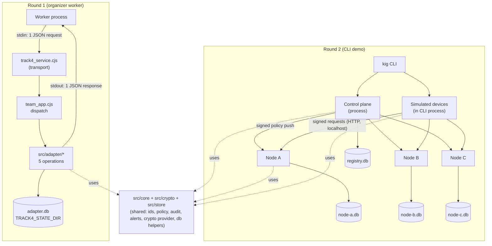
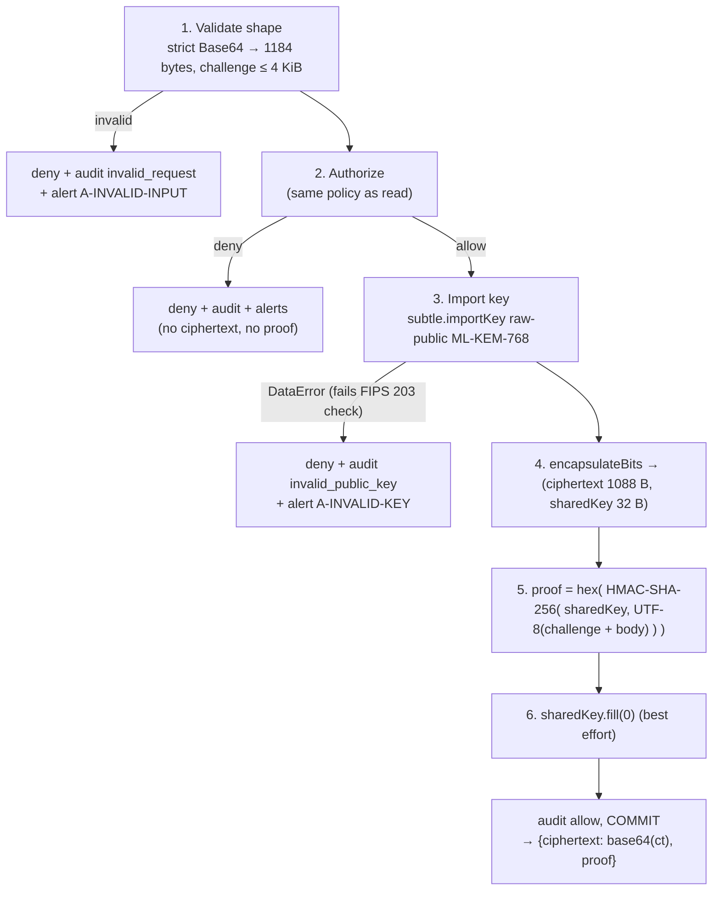
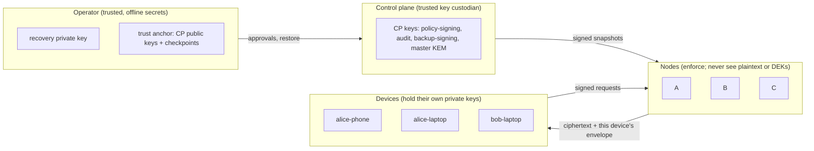
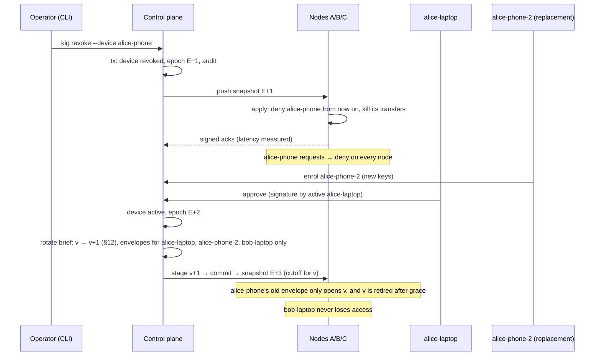
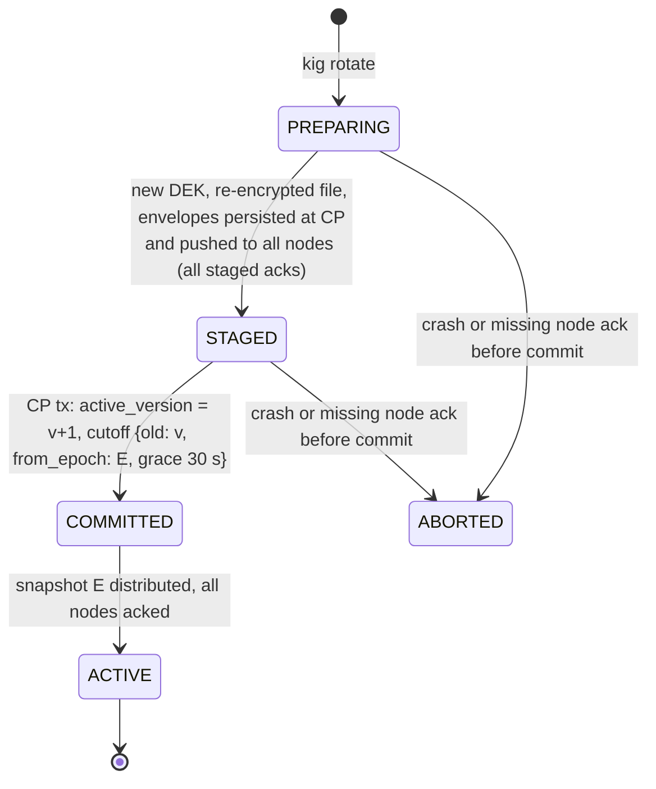
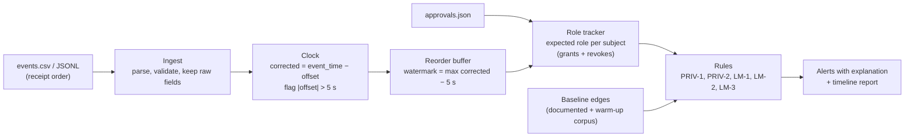

# Key Identity Guard: Architecture

**Track:** 4 "Trust, but verify"
**Document:** architecture.md
**Status:** Draft v1.0 (2026-11-26), built on `features.md` v0.4
**Purpose:** Explain how the system is built and how a request flows from start to finish: what runs, where state lives, which key protects what, and which Node API does each job.

`features.md` says **what** the product must do and **why** (decisions D-01 to D-17, features P0-xx/P1-xx). This document says **how**. Where the two seem to disagree, `features.md` wins and this document gets fixed.

---

## Contents

1. [The big picture](#1-the-big-picture)
2. [Tech stack](#2-tech-stack)
3. [Repository layout](#3-repository-layout)
4. [Shared foundations](#4-shared-foundations-used-by-both-surfaces)
5. [Round 1: the judging adapter](#5-round-1-the-judging-adapter-end-to-end)
6. [Round 2: the KIG system behind the CLI](#6-round-2-the-kig-system-behind-the-cli)
7. [Key hierarchy](#7-key-hierarchy)
8. [Device identity and request authentication](#8-device-identity-and-request-authentication)
9. [Files, sharing and envelopes](#9-files-sharing-and-envelopes)
10. [Control plane, nodes and policy distribution](#10-control-plane-nodes-and-policy-distribution)
11. [Lost device: revoke, re-enrol, re-key](#11-lost-device-revoke-re-enrol-re-key)
12. [Key rotation and crash recovery](#12-key-rotation-and-crash-recovery)
13. [Backup and restore](#13-backup-and-restore)
14. [Audit log](#14-audit-log)
15. [Detector](#15-detector)
16. [Secure messaging](#16-secure-messaging)
17. [The CLI and the Round 2 demo script](#17-the-cli-and-the-round-2-demo-script)
18. [Testing, CI and evidence](#18-testing-ci-and-evidence)
19. [Threat model summary](#19-threat-model-summary)
20. [Things to verify in S0](#20-things-to-verify-in-s0-before-relying-on-them)
21. [Glossary](#21-glossary)

---

## 1. The big picture

### 1.1 Two rounds, two surfaces, one core

The hackathon judges us twice, through two different entry points (D-17):

| | **Round 1: automated** | **Round 2: judges** |
|---|---|---|
| Who runs it | Organizer's worker, in an offline **ARM64** Linux container | Us, in front of the judges |
| Entry point | `track4_service.cjs` at the repo root | `kig` CLI (`node kig.cjs …`) |
| What it exercises | 5 operations: `setup`, `read`, `revoke`, `audit`, `protected_read`, plus hidden tests and exploits | All 12 track goals: devices, 3 nodes, rotation, revocation, crash recovery, backups, audit verification, detection, messaging |
| How a request arrives | One JSON object on stdin, **one process per request** | CLI commands; long-running node processes on localhost |
| Where state lives | One SQLite file in `TRACK4_STATE_DIR` (or the OS temp dir) | Several SQLite files under `KIG_HOME` (control plane, 3 nodes, devices) |
| Attacker we defend against | Anyone who controls the JSON input (D-15) | Revoked devices, replayed messages, tampered backups and logs, unusual service access |

Both surfaces use **the same core modules** (identifier encoding, policy checks, audit chain, alerts, crypto provider, database helpers). There is never a second implementation of a security rule.



### 1.2 The story the whole system tells

All of this exists to tell one story (features §1.2): *an owner shares a protected file → the owner's device is lost → that device is revoked on every node → the owner enrols a replacement → the file is re-keyed so the old device's material is useless → the peer never loses access → every step is in a tamper-evident log → the detector explains suspicious behaviour.* Round 1 tests a compressed version of this story through the adapter. Round 2 tells the full version through the CLI.

### 1.3 Design rules that shape everything

1. **Deny by default.** Missing, corrupt, stale or unverifiable state never produces `allow`.
2. **Commit before acknowledging.** A decision and the audit event that records it are written in one SQLite transaction, and only then is the response sent.
3. **Zero runtime dependencies.** Only Node 24.11.1 built-ins. Nothing to install, nothing to compile on ARM.
4. **One crypto module.** Only `src/crypto/provider.cjs` touches `node:crypto`.
5. **Identifiers are opaque.** Every client-supplied string is stored JSON-encoded (D-04) and never used as a path, SQL fragment, object key or log delimiter.
6. **Honest limits.** Anything we do not defend is written in the threat model (§19).

---

## 2. Tech stack

### 2.1 Runtime (what the judges run)

| Layer | Choice | Notes |
|---|---|---|
| Runtime | **Node.js 24.11.1**, `linux-arm64` in judging | Bundles OpenSSL 3.5.4 (PQC support) and SQLite 3.50.4. Version pinned by organizers. Node 24.1.x would **not** work (OpenSSL 3.0, no ML-KEM/ML-DSA). |
| Module system | CommonJS (`.cjs`), no build step, no TypeScript compile | `// @ts-check` + JSDoc for editor type hints only |
| npm dependencies | **None** | `package.json` exists only for `scripts` and `engines`, with no `dependencies` |
| Language features | Plain JavaScript; `Map`/`Set` for anything keyed by client input | Never index plain objects with client strings (P0-05) |

### 2.2 Built-in modules and what each one does

| Purpose | Node API | Used by |
|---|---|---|
| **ML-KEM-768** (key encapsulation, FIPS 203) | WebCrypto: `subtle.importKey('raw-public', …, {name:'ML-KEM-768'})`, `subtle.encapsulateBits`, `subtle.decapsulateBits`. KeyObject: `crypto.generateKeyPairSync('ml-kem-768')`, `crypto.encapsulate`, `crypto.decapsulate` | `protected_read`, file envelopes, backup wrapping, messaging handshake |
| **ML-DSA-65** (signatures, FIPS 204) | `crypto.generateKeyPairSync('ml-dsa-65')`, `crypto.sign(null, data, {key, context})`, `crypto.verify(null, data, {key, context}, sig)` | Device requests, policy snapshots, audit checkpoints, backup manifests, handshake transcripts |
| **AES-256-GCM** (AEAD) | `crypto.createCipheriv('aes-256-gcm', key, nonce12)` + `setAAD` + `getAuthTag`; `createDecipheriv` + `setAuthTag` | File contents, DEK wrapping, backups, message records |
| **HKDF-SHA-256** | `crypto.hkdfSync('sha256', ikm, salt, info, 32)` (returns an `ArrayBuffer`; wrap in `Buffer.from`) | Every derived key |
| **HMAC-SHA-256** | `crypto.createHmac('sha256', key)`; compare with `crypto.timingSafeEqual` | `protected_read` proof, key confirmation |
| **SHA-256** | `crypto.createHash('sha256')` | Audit chain, transcript hashes, digests |
| Randomness | `crypto.randomBytes`, `crypto.randomUUID` | Keys, nonces, challenges, IDs |
| Persistence | `node:sqlite` → `DatabaseSync` (`exec`, `prepare`, `run`, `get`, `all`, `timeout` option) | Every store |
| Files | `node:fs` (sync API), `node:path`, `node:os` | State dirs, quarantine, backups |
| HTTP between processes (Round 2 only) | `node:http` on `127.0.0.1` | Control plane ↔ nodes, devices → nodes |
| Child processes (Round 2 only) | `node:child_process` (`spawn`) | Starting/stopping/killing the 3 nodes and control plane |
| CLI parsing | `util.parseArgs` | `kig` commands |
| Clocks | `process.hrtime.bigint()` (monotonic, system-wide on Linux), `Date.now()` (wall clock) | Grace windows, latency, leases; event timestamps |
| Tests | `node:test` + `node:assert` (`node --test`) | All tests: no Jest/Mocha needed |

Algorithm and size reference (measured):

| Algorithm | Public key | Private key (stored as) | Ciphertext / signature | Shared secret / tag |
|---|---|---|---|---|
| ML-KEM-768 | 1184 B | 64 B seed (PKCS#8 86 B) | ct 1088 B | ss 32 B |
| ML-DSA-65 | 1952 B | 32 B seed (PKCS#8 54 B) | sig 3309 B | n/a |
| AES-256-GCM | key 32 B | n/a | ciphertext = plaintext length | nonce 12 B, tag 16 B |
| HKDF / HMAC / SHA-256 | n/a | n/a | n/a | 32 B |

### 2.3 Development-only tools (never on the judging path)

| Tool | Why |
|---|---|
| Python 3.12 + `pqcrypto==0.4.0` | Cross-implementation test: a second, independent ML-KEM decapsulates our `protected_read` output (what the organizer's worker does). Skipped with a visible notice if absent. |
| Toolkit `validate.py` | Official local check of the adapter contract |
| Docker (`node:24.11.1` image, `--platform linux/arm64`) | Rehearse the judging container: read-only root, offline, writable temp |
| GitHub Actions on **`ubuntu-24.04-arm`** | Native ARM64 CI: compat, tests, validator, performance numbers |
| pandoc or Typst | 2-page brief PDF |
| OBS + unlisted YouTube | 5-minute fallback video |

### 2.4 What is deliberately not used

| Not used | Reason |
|---|---|
| Any npm package (express, sqlite3, better-sqlite3, jest, …) | Nothing may be installed during judging; native modules would also need ARM builds |
| A custom cipher, MAC, KEM or signature | Disqualifying ("custom cryptographic primitive") |
| Any ML/AI library | Disqualifying in the product |
| Redis/PostgreSQL/message brokers | External services; SQLite is enough |
| Session resumption | Not supported by design (D-05) |
| X25519 hybrid | Optional P2-02, only as X-Wing per the draft |

---

## 3. Repository layout

```
devforge/
├── track4_service.cjs        # Round 1 entry point (adapted toolkit starter, §5.2)
├── team_app.cjs              # dispatch(request) → src/adapter
├── kig.cjs                   # Round 2 CLI entry point: node kig.cjs <command>
├── package.json              # scripts + engines only; no dependencies
├── README.md                 # clean-machine setup, dependency list, how to run everything
├── src/
│   ├── adapter/
│   │   ├── index.cjs         # op routing, error policy (D-13), response shapes (D-16)
│   │   ├── validate.cjs      # request schemas, size caps, strict Base64
│   │   └── ops.cjs           # setup, read, revoke, audit, protected_read
│   ├── core/
│   │   ├── ids.cjs           # D-04 opaque identifier encoding
│   │   ├── policy.cjs        # authorize(): the only place access decisions are made
│   │   ├── audit.cjs         # event encoding (D-08), append, verify, checkpoints
│   │   ├── alerts.cjs        # P0-10 / P1-17 alert rules
│   │   ├── encoding.cjs      # length-prefixed binary encoder (shared by audit, transcripts, AAD)
│   │   └── limits.cjs        # all size caps and timing constants in one place
│   ├── crypto/
│   │   └── provider.cjs      # the ONLY importer of node:crypto
│   ├── store/
│   │   ├── db.cjs            # open, pragmas, busy retry, quarantine, transactions
│   │   ├── schema-adapter.cjs
│   │   ├── schema-cp.cjs
│   │   ├── schema-node.cjs
│   │   └── schema-device.cjs
│   ├── cp/                   # control plane: registry, enrol, revoke, rotate, backup, policy snapshots
│   ├── node/                 # service node: HTTP server, request auth, transfers, policy apply, lease
│   ├── device/               # simulated client device: keystore, signing, envelope open, messaging endpoint
│   ├── messaging/            # handshake, record layer, replay window, chunking, transport simulator
│   ├── detect/               # ingest, clock, reorder buffer, role tracker, rules, generator, bench
│   └── cli/                  # one file per command group; demo script; crash-test; bench; compat
├── tests/
│   ├── unit/                 # per module
│   ├── adapter/              # spawn track4_service.cjs per request, like the worker
│   ├── negative/             # hostile inputs, P0-08 list
│   ├── crash/                # SIGKILL at named points
│   ├── interop/              # Python + pqcrypto (dev-only)
│   └── fixtures/             # practice data copies, generator seeds (test-only randomness)
├── evidence/                 # validator output, bench results, evidence sheet
└── docs/                     # ps.md, features.md, architecture.md, implementation-plan.md, brief/
```

`threat-model.json` is **not** shipped (P0-09): the toolkit's example `boundary: identity-check` does not describe an adapter whose `actor` is a trusted input.

---

## 4. Shared foundations (used by both surfaces)

### 4.1 Opaque identifiers (`core/ids.cjs`, D-04)

Every client-supplied string (actor, asset, request ID, file ID, device ID, **and file bodies**) is stored as `JSON.stringify(value)`.

- **Why:** SQLite TEXT silently turns a lone surrogate (`"\ud800"`) into U+FFFD, so two different IDs collide, and an embedded NUL truncates the string. `JSON.stringify` is injective for every JS string, so every distinct input stays distinct and round-trips exactly (measured).
- **Lookups:** `WHERE actor = ?` with `ids.enc(actor)` as the bound parameter.
- **Never:** used as a file name, concatenated into SQL, or used as a plain-object key.

### 4.2 Length-prefixed encoding (`core/encoding.cjs`, D-08)

One small encoder is used for every byte string that gets hashed, signed or used as AEAD associated data:

```
encode(label, fields[]) = u32(len(label)) ‖ label ‖ for each field: u32(len(field)) ‖ field
null field              = u32(0xFFFFFFFF)            (distinct from the empty string)
integers                = 8-byte big-endian
strings                 = UTF-8 bytes of the D-04 JSON encoding
```

Because every field carries its length, no user text can fake a field boundary. A newline plus fake JSON inside an actor name is just bytes inside one field.

### 4.3 Database helper (`store/db.cjs`)

Every store, from the adapter's single file to the CLI's control-plane and node databases, opens through the same helper:

1. `new DatabaseSync(path, { timeout: 5000 })` (busy timeout 5 s).
2. Retry open plus the first statement up to 3 times with 20–80 ms random jitter on `database is locked`/`SQLITE_BUSY` (the cold-start race, P0-03).
3. Pragmas on every open: `synchronous=FULL`, `foreign_keys=ON`. `journal_mode` is **only set by the code that creates the database** (`setup` for the adapter, `init` for CLI stores); everyone else reads it.
4. Check `PRAGMA user_version` against the expected schema version; mismatch → treated as unusable state.
5. Tables are `STRICT`.
6. `tx(db, fn)`: `BEGIN IMMEDIATE` → `fn()` → `COMMIT`; any throw → `ROLLBACK` and rethrow. `BEGIN IMMEDIATE` takes the write lock up front, which serialises concurrent processes and keeps the audit chain linear.
7. Corrupt file (open or first query throws something other than busy) → caller decides per D-13; `setup` **quarantines** it by renaming to `adapter.db.quarantine-<epochms>` (never deletes).

### 4.4 Audit chain (`core/audit.cjs`)

Every store has an append-only `audit_events` table with a hash chain. §14 has the full design; the adapter uses a subset of it.

### 4.5 Crypto provider (`crypto/provider.cjs`)

A thin wrapper exposing only the operations the system needs, with fixed parameters:

```
kemGenerate() / kemImportRawPublic(bytes) / kemEncapsulate(pub) / kemDecapsulate(priv, ct)
sigGenerate() / sign(priv, context, bytes) / verify(pub, context, bytes, sig)
aeadSeal(key32, nonce12, aad, plaintext) → ct‖tag   / aeadOpen(...) → plaintext or throw
hkdf(ikm, salt, info, len) / hmac(key, bytes) / hmacEqual(a, b) / sha256(bytes)
random(n) / exportPrivatePkcs8(key) / importPrivatePkcs8(bytes, alg)
selfTest()  // known-answer checks run by `kig compat` (HKDF RFC 5869 TC1, KEM round trip, sig context separation, GCM tamper)
```

Fixed context strings for ML-DSA (domain separation): `kig/v1/request`, `kig/v1/handshake`, `kig/v1/revocation`, `kig/v1/checkpoint`, `kig/v1/backup`. A signature made for one purpose cannot be replayed as another.

---

## 5. Round 1: the judging adapter, end to end

### 5.1 What the worker does

For every operation, the worker starts `node track4_service.cjs` from the repository root, writes one JSON object to its stdin, closes stdin, reads stdout/stderr and the exit code, and kills the process if it exceeds the timeout (8 s in the public validator). Each request is a **fresh process**, so everything that must survive lives in SQLite. The repository root is **read-only**; only the temp directory is writable.

A typical sequence (the public lost-device scenario):

```mermaid
sequenceDiagram
  participant W as Worker
  participant A as Adapter process (new each time)
  participant DB as adapter.db
  W->>A: {"op":"setup", owners, contents, disabled, key_material}
  A->>DB: new generation: assets, owners, disabled; audit "setup"
  A-->>W: {"ready":true}
  W->>A: {"op":"read", actor:maya, asset:brief, request_id:r01}
  A->>DB: authorize → allow; audit event r01
  A-->>W: {"decision":"allow","body":"demo note"}
  W->>A: {"op":"revoke", actor:maya}
  A->>DB: revoked_actors += maya; epoch++; audit "revoke"
  A-->>W: {}
  W->>A: {"op":"read", actor:maya, asset:brief, request_id:r02}
  A->>DB: authorize → deny (actor_revoked); audit r02; alert A-REVOKED-RETRY
  A-->>W: {"decision":"deny"}
  W->>A: {"op":"audit", request_id:r02}
  A->>DB: latest access event for r02 in this generation
  A-->>W: {"request_id":"r02","decision":"deny"}
  W->>A: {"op":"protected_read", actor:peer, asset:x, challenge, public_key}
  A->>DB: authorize → allow; audit
  A-->>W: {"ciphertext": b64(ML-KEM ct), "proof": hex HMAC}
```

### 5.2 Life of one adapter process (every request goes through these steps)

| # | Step | Detail | Failure → |
|---|---|---|---|
| 1 | **Start** | `track4_service.cjs` line 1: `process.removeAllListeners('warning')` so `ExperimentalWarning` (SQLite, ML-KEM) never reaches stderr | n/a |
| 2 | **Read stdin** | Loop `fs.readSync(0, …)` into a buffer until EOF; retry on `EAGAIN`; **stop at 4 MiB** | over cap → `{"error":"invalid_request"}`, exit 0 |
| 3 | **Decode** | `new TextDecoder('utf-8', {fatal:true})`: invalid UTF-8 is rejected, not silently replaced | → `invalid_request`, exit 0 |
| 4 | **Parse** | `JSON.parse`; must be a plain object (not array/null/primitive). Duplicate keys: last wins (JSON.parse behaviour) | → `invalid_request`, exit 0 |
| 5 | **Route** | `op` must be one of the 5 names (compared as strings; looked up in a `Map`) | unknown → `{"error":"unsupported_operation"}`, exit 0 |
| 6 | **Validate** | Per-op schema (§5.3): types, lengths, Base64. Converts `owners`/`contents` to `Map`, `disabled` to `Set` | per-op invalid response (§5.3), alert `A-INVALID-INPUT` where state exists |
| 7 | **Locate state** | `dir = process.env.TRACK4_STATE_DIR \|\| os.tmpdir()`; database at `<dir>/kig/adapter.db`. Only `setup` (and first-ever `revoke`) creates `<dir>/kig/` (mode 0700) | missing DB: read/protected_read/audit → deny |
| 8 | **Open** | `store/db.cjs` open with retry (§4.3) | per D-13 (§5.6) |
| 9 | **Transaction** | `BEGIN IMMEDIATE` → op logic → audit event(s) → alert event(s) → `COMMIT` | rollback; per D-13 |
| 10 | **Respond** | `process.stdout.write(JSON.stringify(response) + '\n')`. On Linux, writes to a pipe are synchronous, so the bytes are out before exit | n/a |
| 11 | **Exit** | Close the DB; set `process.exitCode`; let the event loop drain. No timers, servers or children are ever created, so nothing lingers | n/a |

`track4_service.cjs` is the toolkit starter with three changes: warning suppression, the bounded/fatal-UTF-8 stdin read, and returning `invalid_request` (exit 0) instead of exit 1 for unparseable or non-object input. Everything else (one object in, one object out, generic stderr line on an unexpected crash) is unchanged.

### 5.3 Request validation (`adapter/validate.cjs`)

Constants live in `core/limits.cjs`:

| Field | Rule |
|---|---|
| any identifier (`actor`, `asset`, `request_id`, owner values, `disabled[]`) | JS string, length ≤ 8192 UTF-16 code units. Any content allowed (empty, NUL, newlines, lone surrogates, `__proto__`…), because IDs are opaque. |
| `owners` | plain object; every value an identifier. Converted to `Map(asset → owner)` with `Object.entries` (own keys only, so `__proto__` from `JSON.parse` is a normal key) |
| `contents` | plain object; every value a string (any length within the 4 MiB request cap). Converted to `Map(asset → body)` |
| `disabled` | array of identifiers → `Set` |
| `key_material` | accepted, **ignored**: never stored, logged, printed or used as key material (P0-04) |
| `challenge` | string, length ≤ 4096 |
| `public_key` | strict standard Base64: `length % 4 === 0`, `/^[A-Za-z0-9+/]*={0,2}$/`, and re-encoding the decoded bytes gives the same string. Decoded length must be exactly **1184** (so the string is exactly 1580 characters). |
| `request_id` on `protected_read` | **optional** identifier. The contract does not send one; if present, it is recorded so `audit` can find it. |

What an invalid request gets back:

| op | Invalid input response |
|---|---|
| `setup` | `{"error":"invalid_request"}`, exit 0, **state untouched** |
| `read`, `protected_read` | `{"decision":"deny"}`, exit 0, audit event with rule `invalid_request` |
| `audit` | `{"request_id": <given or null>, "decision":"deny"}`, exit 0 |
| `revoke` | `{"error":"invalid_request"}`, exit 0, nothing persisted |

### 5.4 Adapter database schema (`store/schema-adapter.cjs`)

```sql
-- user_version = 1; journal_mode = WAL (set by setup); all tables STRICT
CREATE TABLE meta (k TEXT PRIMARY KEY, v TEXT NOT NULL) STRICT;
--   'db_id'        random 16-byte hex, fixed at creation (seeds the chain genesis)
--   'current_gen'  integer as text; 0 = no setup yet
--   'epoch'        monotonic revocation counter, never decreases, survives setup

CREATE TABLE assets (                 -- current generation only (setup replaces)
  asset  TEXT PRIMARY KEY,            -- D-04 encoded
  owner  TEXT,                        -- D-04 encoded, NULL if contents has no owner entry
  body   TEXT                         -- D-04 encoded, NULL if owners has no contents entry
) STRICT;

CREATE TABLE revoked_actors (         -- current generation only
  actor  TEXT PRIMARY KEY,            -- D-04 encoded
  source TEXT NOT NULL CHECK (source IN ('setup_disabled','revoke')),
  epoch  INTEGER NOT NULL
) STRICT;

CREATE TABLE audit_events (           -- append-only, across ALL generations
  seq        INTEGER PRIMARY KEY,     -- 1, 2, 3, … no gaps
  gen        INTEGER NOT NULL,
  ts_ms      INTEGER NOT NULL,        -- wall clock, informational
  kind       TEXT NOT NULL,           -- setup | access | revoke | audit_query | alert
  op         TEXT,                    -- read | protected_read | …
  request_id TEXT,                    -- D-04 encoded or NULL
  actor      TEXT,
  asset      TEXT,
  decision   TEXT CHECK (decision IN ('allow','deny') OR decision IS NULL),
  rule       TEXT,                    -- e.g. owner_allowed, actor_revoked, A-BURST
  detail     TEXT,                    -- small JSON, never secrets or bodies
  prev_hash  BLOB NOT NULL,
  hash       BLOB NOT NULL
) STRICT;
CREATE INDEX audit_by_req   ON audit_events(gen, request_id, seq);
CREATE INDEX audit_by_actor ON audit_events(gen, actor, ts_ms);
CREATE TRIGGER audit_no_update BEFORE UPDATE ON audit_events BEGIN SELECT RAISE(ABORT,'append-only'); END;
CREATE TRIGGER audit_no_delete BEFORE DELETE ON audit_events BEGIN SELECT RAISE(ABORT,'append-only'); END;
```

Bodies are stored as plaintext (JSON-encoded) on purpose: the adapter has no secret that lives outside this directory, so encryption here would protect nothing (D-14). Under D-15, the state directory is outside the Round 1 attacker's reach.

### 5.5 The five operations in detail (`adapter/ops.cjs`)

All five run inside one `BEGIN IMMEDIATE` transaction, and **all of them write**: even a `read` appends an audit event.

#### `setup`
1. Validate (§5.3). Create `<dir>/kig/` if missing.
2. If `adapter.db` exists but is unusable (corrupt, wrong schema) → rename to `adapter.db.quarantine-<ms>`.
3. Open; if newly created: `PRAGMA journal_mode=WAL` (check the result is `wal`, else continue in `DELETE` mode), create schema, write `db_id`, `current_gen=0`, `epoch=0`.
4. Transaction:
   - `current_gen += 1` (a **new generation**, D-01).
   - `DELETE FROM assets; DELETE FROM revoked_actors;` (mutable state only; audit is never touched).
   - Insert one `assets` row per asset seen in `owners` **or** `contents`.
   - Insert each `disabled` actor into `revoked_actors` with `source='setup_disabled'`, `epoch = epoch+1` (epoch bumps once).
   - Append audit event `kind=setup` with counts only (`{"assets":n,"disabled":m}`), never contents and never `key_material`.
5. After `COMMIT`: respond `{"ready":true}`.

#### `read`
1. Validate. No DB or `current_gen = 0` → deny, rule `no_state` (no write is possible; nothing to audit).
2. Transaction: `decision, rule = policy.authorizeOwnerRead(actor, asset)`:

   | Order | Check | Result |
   |---|---|---|
   | 1 | actor in `revoked_actors` | deny `actor_revoked` |
   | 2 | asset row missing, or `owner`/`body` is NULL | deny `unknown_asset` |
   | 3 | `owner ≠ actor` | deny `not_owner` |
   | 4 | otherwise | allow `owner_allowed` |

   Revocation is checked **before** ownership, so a revoked owner never reaches the body.
3. Append audit event `kind=access, op=read, request_id, actor, asset, decision, rule`.
4. Run alert rules (§5.7); append any alert events.
5. `COMMIT`, then respond `{"decision":"allow","body":<decoded body>}` or `{"decision":"deny"}`, and nothing else (no `rule`, no debug fields).

#### `revoke`
1. Validate. If no DB exists yet, create the store (as in setup step 3) with `current_gen = 0`: a revocation must be persisted even if it arrives first.
2. Transaction: `epoch += 1`; `INSERT INTO revoked_actors … ON CONFLICT DO NOTHING` (idempotent; works for actors never named in `setup`); audit event `kind=revoke`.
3. After `COMMIT` → `{}`. If anything fails, **exit non-zero with no stdout**: an unpersisted revocation must never be acknowledged.

Revoking one actor touches only that actor's row, so other actors keep their permissions.

#### `audit`
1. Validate `request_id`.
2. Transaction: `SELECT decision FROM audit_events WHERE gen = current_gen AND kind = 'access' AND request_id = ? ORDER BY seq DESC LIMIT 1`.
   - Found → `{"request_id":…, "decision":…}` (the **latest** attempt, D-02).
   - Not found (including IDs from an earlier generation) → `{"request_id":…, "decision":"deny"}` (D-03), plus an `audit_lookup_miss` event in the log.
3. Append audit event `kind=audit_query` (so lookups are themselves visible), `COMMIT`, respond.

#### `protected_read`
Order is fixed (P0-07):



- The worker decapsulates `ciphertext` with its private key, recomputes the HMAC and compares. Interop with an independent implementation (`pqcrypto`) is 25/25 in testing.
- The shared secret is never stored, logged or returned.
- Allowed responses contain only `ciphertext` and `proof` (D-16); denials contain only `{"decision":"deny"}`.
- One edge to know: if a body contains a lone surrogate, its UTF-8 encoding is U+FFFD. Both sides encode the same way only if the worker does too. The test suite pins our behaviour (Node `Buffer.from(str, 'utf8')`).

### 5.6 Error policy (D-13) as implemented

`team_app.cjs` wraps each op in its own `try/catch`. The transport's last-resort catch only handles truly unexpected crashes.

| Situation | `read` / `protected_read` | `audit` | `revoke` | `setup` |
|---|---|---|---|---|
| Invalid input | deny, exit 0 | deny shape, exit 0 | `invalid_request`, exit 0 | `invalid_request`, exit 0 |
| DB missing | deny `no_state`, exit 0 | deny shape, exit 0 | creates store, records, `{}` | creates store |
| DB locked after retries | deny, exit 0 (alert attempted) | deny shape, exit 0 | **exit 1**, no stdout | **exit 1** |
| DB corrupt | deny, exit 0 | deny shape, exit 0 | **exit 1**, no stdout | quarantine + fresh store, `{"ready":true}` |
| Unexpected exception | deny, exit 0 | deny shape, exit 0 | **exit 1** | **exit 1** |

stderr only ever receives one fixed line (`Request failed; inspect team application locally.`) and only on exit 1. No stack traces, IDs, bodies or keys.

### 5.7 Adapter alerts (P0-10)

Evaluated inside the same transaction as the decision; each alert is an `audit_events` row with `kind='alert'`:

| Rule | Fires when | Severity |
|---|---|---|
| `A-REVOKED-RETRY` | revoked/disabled actor attempts `read`/`protected_read` | medium |
| `A-CROSS-OWNER` | actor requests an existing asset it does not own | low |
| `A-INVALID-INPUT` | request fails validation | low |
| `A-INVALID-KEY` | ML-KEM key fails the FIPS 203 import check | medium |
| `A-HOSTILE-ID` | identifier contains control chars, NUL, lone surrogates, `../`, or a prototype key (`__proto__`, `constructor`, `prototype`); still processed normally | info |
| `A-BURST` | ≥ 5 denials for the same actor in 60 s (counted with `audit_by_actor`) | high |
| `A-STATE-FAULT` | DB corrupt/missing/locked (recorded when a write is still possible) | high |

Alerts never change the response, never print anything and never lock anyone out. They are the "detect" half of the assessment's detect-and-respond rule, and the operator reads them with `kig alerts --adapter <dir>`.

### 5.8 Performance profile

Each request costs Node startup plus module loading plus one SQLite transaction. Measured on x86-64 (WSL): ~45 ms for an empty Node process, ~55 ms with SQLite and ML-KEM loaded. This is under 1% of the 8 s budget. ARM numbers are measured in CI (§18). To keep startup low, the adapter loads only `src/adapter`, `src/core`, `src/crypto`, `src/store`; the CLI-only modules are never `require`d on this path.

---

## 6. Round 2: the KIG system behind the CLI

### 6.1 Components

| Component | Process | Holds | State |
|---|---|---|---|
| **Control plane (CP)** | One long-running Node process, HTTP on `127.0.0.1:7400` | Registry of accounts, devices, approvals, files, key versions; signs policy snapshots; runs rotations; makes backups | `KIG_HOME/cp/registry.db`, `KIG_HOME/cp/keys/` |
| **Nodes A, B, C** | Three Node processes, ports 7401–7403 | Ciphertext and envelopes for files; latest signed policy snapshot; challenges; in-flight transfers | `KIG_HOME/nodes/<id>/node.db` |
| **Devices** | Simulated inside the CLI process (one keystore each) | The device's ML-DSA signing key and ML-KEM envelope key | `KIG_HOME/devices/<device-id>/device.db` |
| **Operator** | The person at the CLI | Operator recovery KEM key (offline), trust anchor | `KIG_HOME/operator/` (recovery private key), `KIG_HOME/anchor/` (pinned public keys, latest checkpoints) |
| **Detector** | Runs inside the CLI on demand | Nothing persistent | Reads event files, writes alert reports to `evidence/` |

`KIG_HOME` defaults to `<os.tmpdir()>/kig-demo` and can be overridden. `kig reset` deletes it after confirmation.

### 6.2 Trust boundaries



- **Nodes** trust only what is signed by the CP policy key (pinned at node bootstrap). They never hold file keys, so a compromised node leaks ciphertext only.
- **Devices** trust the CP public key (pinned at enrolment) and their own keys.
- **The CP** is the key custodian (a KMS model): it can decrypt files. This is stated in the threat model.

---

## 7. Key hierarchy

Every key has exactly one purpose (features §8.4). "Stored as" means PKCS#8 DER of the seed form unless stated.

| Key | Algorithm | Purpose | Created by / when | Private part lives in | Public part known by |
|---|---|---|---|---|---|
| CP policy-signing key | ML-DSA-65 | Signs policy snapshots (revocations, device list, active key versions), ctx `kig/v1/revocation` | `kig init` | `cp/keys/` (file mode 0600) | Nodes, devices, anchor |
| CP audit key | ML-DSA-65 | Signs CP audit checkpoints, ctx `kig/v1/checkpoint` | `kig init` | `cp/keys/` | Anchor |
| CP backup-signing key | ML-DSA-65 | Signs backup manifests, ctx `kig/v1/backup` | `kig init` | `cp/keys/` | Anchor |
| CP master KEM key | ML-KEM-768 | Wraps every file DEK at the CP (custodian copy) | `kig init` | `cp/keys/` | CP only |
| Node identity key | ML-DSA-65 | Signs node acks and node checkpoints | `kig node add` | `nodes/<id>/` | CP, anchor |
| Device signing key | ML-DSA-65 | Device identity: signs requests (`kig/v1/request`) and handshakes (`kig/v1/handshake`) | On the device at enrolment | `devices/<id>/` | CP registry → nodes, peers |
| Device envelope key | ML-KEM-768 | Receives file DEK envelopes | On the device at enrolment | `devices/<id>/` | CP registry |
| Ephemeral session key | ML-KEM-768 | One messaging session; gives forward secrecy | Per handshake, in memory | Memory only, wiped on close | The peer, for that session |
| File DEK (per file, per version) | AES-256 | Encrypts one file version | CP, at publish and every rotation | Only wrapped: under the CP master KEM key and in device envelopes | n/a |
| Operator recovery key | ML-KEM-768 | Unwraps backups (D-07) | `kig init` writes it to `operator/` | **Offline** (operator), supplied at restore | CP (public half) |
| `key_material` (adapter) | n/a | Synthetic marker: **never used** (P0-04) | n/a | n/a | n/a |

The adapter (Round 1) needs **no long-term keys at all**: `protected_read` uses the worker's one-time public key.

Seed and DEK wrapping use one pattern everywhere:

```
kemWrap(recipientPub, dek, context):
  (ct, ss) = ML-KEM-768.Encaps(recipientPub)
  k        = HKDF-SHA-256(ikm=ss, salt=ct, info=encode("kig/v1/wrap", context...), 32)
  nonce    = random 12 B            (fresh key every time, so a random nonce is safe: D-10)
  wrapped  = AES-256-GCM(k, nonce, aad=encode(context...), dek)
  return { ct, nonce, wrapped }     ss and k are wiped after use
```

---

## 8. Device identity and request authentication

### 8.1 Enrolment (P1-01, P1-03)

```mermaid
sequenceDiagram
  participant Dv as New device (CLI)
  participant CP as Control plane
  participant Ap as Approver (existing device or operator)
  Dv->>Dv: generate ML-DSA-65 signing key + ML-KEM-768 envelope key
  Dv->>CP: enrol request {account, device_id, sign_pk, kem_pk}<br/>signed by the new sign key (proof of possession)
  CP->>CP: verify signature; device status = pending
  Ap->>CP: approval: signature by another ACTIVE device of the same account,<br/>or operator approval with an approval_id
  CP->>CP: tx: status = active, audit "device_enrolled"
  CP->>CP: new policy snapshot (epoch+1) listing the device
  CP-->>Dv: CP policy public key (device pins it)
```

- The **first** device of an account needs an operator approval. Later devices need an approval from an existing active device **or** the operator (the social-engineering guard, P1-03).
- Holding an unregistered public key proves nothing. A device counts only once it is `active` in a signed snapshot.

### 8.2 Authenticated request to a node

```mermaid
sequenceDiagram
  participant Dv as Device
  participant N as Node
  Dv->>N: GET /v1/challenge
  N->>N: nonce = random 32 B; store (nonce, expires = now + 30 s, used = 0)
  N-->>Dv: nonce
  Dv->>Dv: transcript = encode("kig/v1/request", version, op, account, device, resource, request_id, nonce, key_version)
  Dv->>N: POST /v1/<op> {fields…, sig = Sign(device key, ctx kig/v1/request, transcript)}
  N->>N: tx: lease fresh? device active in snapshot? not revoked?<br/>nonce exists, unexpired, unused → mark used<br/>verify signature; check key_version rules (§12)<br/>authorize (grants); audit event
  N-->>Dv: decision (+ ciphertext and this device's envelope if allowed)
```

Rejected (each with its own audit rule): altered fields (signature fails), reused nonce, expired nonce, unknown device, wrong-context signature, revoked device, stale lease, old key version after cutoff.

---

## 9. Files, sharing and envelopes

### 9.1 Publish a file

1. Owner's device sends the plaintext to the CP over the CLI (the CP is the custodian; KMS model).
2. CP: `DEK = random(32)`; `nonce = random(12)`; `ct = AES-256-GCM(DEK, nonce, aad = encode(file_id, version, "kig/v1/file"), plaintext)`.
3. CP stores `kemWrap(CP master KEM pub, DEK, [file_id, version, "cp"])` (custodian copy).
4. For every **active device of every account with a grant** on the file: `kemWrap(device kem_pk, DEK, [file_id, version, account, device_id, "kig/v1/envelope"])`.
5. CP pushes ciphertext and envelopes to all nodes (staged → active through the normal snapshot, §10).
6. Plaintext and DEK are wiped from memory; the CP database never holds plaintext.

### 9.2 Read a file (device side)

1. Device makes an authenticated request (§8.2) for `file_id` at the active `version`.
2. Node returns `ct`, `nonce` and **only this device's envelope**.
3. Device: decapsulate with its envelope key → HKDF → AES-GCM-open the DEK → AES-GCM-open the file. Any altered byte in ciphertext, nonce, tag or associated data fails. An envelope for device A cannot be opened as device B (the device ID is in both the HKDF info and the AAD).

### 9.3 Sharing

`kig share <file> --with <account>` adds a grant and creates envelopes for that account's active devices (no re-encryption needed). Removing a grant triggers a rotation (§12) so the removed account's old envelopes stop working for future versions.

---

## 10. Control plane, nodes and policy distribution

### 10.1 The signed policy snapshot

Everything a node needs to make decisions arrives in one signed object:

```
PolicySnapshot {
  epoch            : u64, strictly increasing, never reused
  issued_at_ms     : wall clock (informational)
  devices          : [{device_id, account, sign_pk_sha256, status}]   (full sign_pk fetched once and cached by hash)
  revoked_devices  : [device_id]   (also status = revoked above; kept explicit for clarity)
  files            : [{file_id, active_version, cutoff: {old_version, from_epoch, grace_ms} | null}]
  grants           : [{file_id, account}]
  lease_ms         : how long a node may act without fresh contact (default 5000)
}
signed: ML-DSA-65(CP policy key, ctx "kig/v1/revocation", encode(snapshot))
```

### 10.2 How a node applies a snapshot

1. Verify the signature with the pinned CP policy key; reject otherwise.
2. Reject if `epoch ≤ applied_epoch` (stale or replayed snapshot).
3. In one transaction: store it, set `applied_epoch`, record `applied_at_mono`, terminate in-flight transfers and challenges of newly revoked devices, record each new cutoff with `cutoff_applied_mono`.
4. Acknowledge to the CP: `{node_id, epoch}` signed by the node key.

### 10.3 Push, pull and lease

- **Push:** after every commit the CP `POST`s the snapshot to each node.
- **Pull:** each node polls `GET /v1/policy/head?nonce=<random>` every 250 ms. The CP returns `{epoch, nonce}` signed, so the node knows the answer is fresh (an old reply can't be replayed). If the epoch is newer, the node fetches the full snapshot.
- **Lease:** each fresh head refreshes `lease_until = now_mono + lease_ms`. If the lease expires (CP unreachable, partition), the node **fails closed**: it denies all protected operations until it reconnects. This is the enforcement bound we report for partitions, instead of claiming "instant".

### 10.4 Measuring revocation propagation (P1-05)

`kig bench revocation --n 100 --seed S`, all inside the CLI process with one monotonic clock (`process.hrtime.bigint()`):

1. `t0` = the CP commit of revocation `i`.
2. In parallel, probe each node every 1 ms with a signed request from the revoked device; `t_deny(node)` = first denial.
3. `t_ack(node)` = the node's signed ack arriving at the CP.
4. Report p50/p95/max per node and for the last node, plus the partition test (one node isolated → denial at lease expiry).

---

## 11. Lost device: revoke, re-enrol, re-key

This is the heart of the Round 2 demo. Alice has `alice-phone` and `alice-laptop`; Bob has `bob-laptop`; the file `brief` is shared between Alice and Bob.



What we claim, and what we do not: after the revocation is applied on every node, the lost device gets **no new** content and no new sessions. Content or keys it copied *before* the loss cannot be recalled (features §1.3).

---

## 12. Key rotation and crash recovery

### 12.1 State machine (P1-04)



The old version moves `ACTIVE → RETIRING` (during grace) `→ RETIRED`; nodes delete retired ciphertext after the grace period.

### 12.2 Cutoff and grace (D-06)

- The cutoff is an **epoch**, not a wall-clock time: a node enforces it from the moment it applies snapshot `E`.
- After that moment, a **new** transfer naming version `v` is rejected (`old_key_after_cutoff`), even inside the grace window.
- A transfer that was **already authenticated** before the cutoff (it holds a transfer ID bound to `v`) may keep fetching chunks until `cutoff_applied_mono + 30 s` on that node's monotonic clock. After that it is terminated.
- Grace period: **yes, 30 s, node-local**, stated in the evidence sheet as the PS requires.

### 12.3 Crash-safe journal (P1-06)

The CP writes each phase to `rotation_journal` in its own transaction **before** acting on it: `PREPARE → REWRAP → STAGE → COMMIT → DISTRIBUTE → COMPLETE`.

On CP startup (`cp/recover.cjs`):

| Last durable phase | Recovery action |
|---|---|
| PREPARE, REWRAP or STAGE (no COMMIT) | **Abort**: discard v+1 at the CP, tell nodes to drop staged v+1, keep v active |
| COMMIT or DISTRIBUTE | **Roll forward**: re-push snapshot `E` until every node acks, then COMPLETE |
| COMPLETE | Nothing |

Extra rules:
- Recovery never lowers the epoch and never re-activates a revoked device.
- A node refuses snapshots older than the highest epoch it has ever recorded, so restoring an old node DB file can't bring a revoked device back.
- After recovery, every committed file version is test-decrypted through a custodian envelope to prove it is still readable.

`kig crash-test` starts the CP with `KIG_CRASH_AT=<phase>`. The CP `SIGKILL`s itself at that exact point; the harness restarts it, runs recovery and checks the invariants. The points are: after prepare, after stage, just before commit, just after commit, and during distribution.

---

## 13. Backup and restore

### 13.1 Making a backup (`kig backup`)

1. `VACUUM INTO '<tmp>/snapshot.db'` produces a consistent copy of `registry.db` (§20 lists this as an S0 check).
2. `DEK_b = random(32)`; `payload = AES-256-GCM(DEK_b, random nonce, aad = encode(backup_id, schema), snapshot bytes)`.
3. `wrap = kemWrap(operator recovery public key, DEK_b, [backup_id, "kig/v1/backup"])`.
4. `manifest = {backup_id, schema_version, key_versions, revocation_epoch, log_seq, payload_sha256, algorithms}`.
5. `manifest.sig = ML-DSA-65(CP backup-signing key, ctx kig/v1/backup, encode(manifest))`.
6. Output directory: `manifest.json`, `manifest.sig`, `wrap.bin`, `payload.bin`.

### 13.2 Restoring (`kig restore <dir> --recovery-key <path> --anchor <path>`)

These checks run in order. The first failure stops the restore and reports its category; **live state is untouched**.

| # | Check | Failure category |
|---|---|---|
| 1 | Manifest signature, with the backup public key **from the anchor** (never from the backup itself) | `bad_signature` |
| 2 | `schema_version` supported | `unsupported_schema` |
| 3 | SHA-256(payload) = `payload_sha256` (catches flipped bits and truncation) | `digest_mismatch` |
| 4 | `revocation_epoch` ≥ the highest epoch the live CP has recorded and ≥ the minimum pinned in the anchor | `stale_backup` (anti-rollback) |
| 5 | Unwrap `DEK_b` with the recovery key; AES-GCM open succeeds | `decrypt_failed` |
| 6 | Restored DB passes `PRAGMA integrity_check` and contains the required key material | `incomplete_backup` |
| 7 | Stop CP → atomic rename of the restored file into place → start CP → recovery (§12.3) | n/a |

---

## 14. Audit log

### 14.1 Event and chain (P1-08)

- Each event is one row with these fields: sequence, generation (adapter only), wall time, receipt time, kind, operation, request ID, actor, device, resource/service, decision, rule, key version, node ID, session/correlation ID, small detail JSON.
- `encoded_n = encode("kig/v1/event", [fields in a fixed order])` (§4.2).
- `hash_0 = SHA-256(encode("kig/v1/genesis", [db_id]))`, and `hash_n = SHA-256(hash_{n-1} ‖ encoded_n)`.
- The append happens inside the same transaction as the decision, so a decision can never exist without its event, or the other way round.
- Triggers block `UPDATE`/`DELETE` on the table (§5.4). This guards against our own bugs, not against someone with file access.

**Injection test:** an actor named `x\n{"actor":"admin","decision":"allow"}` produces exactly one event whose actor field is that whole string.

### 14.2 Checkpoints and the anchor

- The CP and each node sign a checkpoint `{store_id, seq, head_hash, checkpoint_id, prev_checkpoint_id}` every 64 events and at the end of every CLI command (ctx `kig/v1/checkpoint`).
- Each new checkpoint is copied to `KIG_HOME/anchor/<store_id>.json`, **outside** the database.
- The adapter's chain is unsigned during Round 1 (no keys on that path). `kig checkpoint --adapter <dir>` signs its head with the operator audit key when the operator wants to pin it.

### 14.3 `kig verify-log --db <file> --anchor <file>` (offline)

1. Recompute every hash from genesis.
2. Report the **first** broken sequence and classify it:
   - `content_edit`: a row's hash doesn't match its contents.
   - `missing_or_reordered`: a sequence gap, or `prev_hash` doesn't link.
   - `invalid_checkpoint`: a checkpoint signature fails.
   - `truncated`: the log ends before the anchored checkpoint's sequence.
3. Report OK with the verified head and checkpoint.

Stated limit: without an independently kept checkpoint, deleting the newest records can't be detected. That is why the anchor lives outside the store.

---

## 15. Detector

### 15.1 Pipeline



Input is the toolkit's practice format. `kig detect --events … --approvals … [--baseline …]` processes a file; `kig bench detect --seeds …` runs the generator plus metrics. **The detector never reads labels**; only the benchmark scorer does.

### 15.2 Each stage

| Stage | Behaviour |
|---|---|
| Ingest | Keeps `event_time_utc`, `received_time_utc`, `source_clock_offset_ms` and ingestion index untouched; rejects malformed rows into a report instead of guessing |
| Clock | `corrected = event_time − offset`. Supported offset ±5000 ms; outside that → `clock_unsupported`, event kept, ordered by receipt. Uncertainty ±250 ms by default (configurable) |
| Reorder buffer | Releases events in corrected-time order once `corrected ≤ watermark`. Events arriving below the watermark are processed and marked `late`. `order_uncertain = true` when two events of the same actor/session have overlapping uncertainty intervals |
| Role tracker | Replays `grant_role` (scope + `[valid_from, valid_until)`) and `revoke_role` (`effective_at`) approvals so it knows each subject's expected role at each moment (P1-09, v0.3) |
| PRIV-1 | Role **increase** without a matching approval (subject, role, scope, time; the actor may differ from the approver, as in `evt-003`/`evt-004`) → high alert |
| PRIV-2 | Accesses in the same session/flow after a PRIV-1 → linked to that alert (`evt-009` → `evt-008`) |
| LM-1 | ≥ 3 edges not in the baseline, same actor/session/flow, within 60 s → candidate lateral movement |
| LM-2 | One **allowed** request over a non-baseline edge into a sensitive service (identity, billing, archive) → medium |
| LM-3 | ≥ 3 denials across ≥ 2 non-baseline targets within 60 s → low/medium |
| Revocation context | Denials explained by a recent revocation of that actor's role/device → "expected enforcement", excluded from LM-1/LM-3 (`evt-017`, `evt-018`) |

Baseline: documented expected edges from the practice context plus a benign warm-up corpus from the generator, never a cold start (v0.3).

Every alert carries: `alert_id`, `rule_id`, severity, identity, services, ordered path, event IDs, reason in words, allowed/denied per event, `order_uncertain`, and the time window.

### 15.3 Benchmark (P1-18)

- **Generator:** a seeded PRNG (simulation only, not crypto). It produces routine traffic, approved admin, unapproved escalation, unusual paths, denials, revocations, clock skew, reordering, hard benign cases (off-hours approved admin, new hire, new legitimate edge) and evasive attacks (low-and-slow, one- and two-edge paths). It labels its own output.
- **Seeds:** tuning seeds and **held-out** seeds are kept apart.
- **Metrics:** precision, recall, F1 (unit = alert matched to a labelled incident; event-level reported separately), median time-to-alert, and false alerts per 1,000 benign events.
- **Time-to-alert:** from the receipt of the last needed event to the alert's emission, on the collector's monotonic clock, **including the watermark wait** (up to 5 s). It is reported honestly, not hidden.

---

## 16. Secure messaging

Messaging runs between two enrolled devices through a **seeded transport simulator** in the CLI process. That makes loss, duplication and reordering deterministic and repeatable. Identity checks use the same CP registry and snapshots.

### 16.1 Handshake (P1-12)

```mermaid
sequenceDiagram
  participant I as Initiator device
  participant R as Responder device
  I->>I: (ek_e, dk_e) = fresh ML-KEM-768 (ephemeral)
  I->>R: M1 = {ver, suite, I_dev, R_dev, n_i, ek_e, sig_I}<br/>sig_I = Sign(I key, ctx handshake, TH1 = H(encode(M1 fields)))
  R->>R: I active and not revoked? verify sig_I
  R->>R: (ct, ss) = Encaps(ek_e); TH2 = H(TH1 ‖ encode(ct, n_r, R_dev, epoch))
  R->>R: PRK = HKDF-Extract(salt = TH2, ss); keys k_i2r, k_r2i, k_conf
  R->>I: M2 = {ct, n_r, epoch, sig_R over TH2, mac_R = HMAC(k_conf, "R" ‖ TH2)}
  I->>I: verify sig_R; ss = Decaps(dk_e, ct); derive keys; check mac_R; wipe dk_e
  I->>R: M3 = {mac_I = HMAC(k_conf, "I" ‖ TH2)}
  R->>R: check mac_I → session established
```

- `session_id = first 16 B of H("kig/v1/sid" ‖ TH2)`. It is a **label, never a credential** (D-05).
- **Forward secrecy:** the session secret comes only from the ephemeral KEM; long-term keys only sign. Leaking a device's long-term ML-DSA key later reveals nothing about a finished session. The test records a session, closes it, leaks the signing key and shows the transcript still can't be decrypted.

### 16.2 Record layer, replay and recipient binding (P1-12, P1-13)

- Each direction has its own key. Nonce = 4-byte direction ID ‖ 8-byte sequence number, so a nonce never repeats under a key (D-10).
- AAD = `encode("kig/v1/record", ver, suite, session_id, sender_dev, recipient_dev, epoch, msg_id, seq, chunk_idx, chunk_total)`.
- The receiver checks `recipient_dev == self` **before** decrypting; changing any AAD field breaks the tag anyway.
- **Replay:** per session and direction, it keeps the highest sequence number plus a 64-bit sliding-window bitmap, and a set of seen `msg_id`s. This is persisted in `device.db`, so a restarted receiver still rejects replays.
- Records from a session whose peer is revoked at the current epoch are rejected; a revoked device can't complete a new handshake.

### 16.3 Chunking and delivery (P1-15)

- Messages are split into chunks of at most 16 KiB. Every chunk is its own AEAD record whose AAD carries `msg_id`, `chunk_idx` and the **authenticated** `chunk_total`, so a truncated message can't pass as complete.
- **Receiver limits:** 256 chunks per message, 4 MiB per message, 8 MiB of buffered data in total, and a 5 s reassembly timeout.
- **Sender:** retries un-acked chunks up to 3 times.
- **Three outcomes are reported separately:** transport receipt, reassembly complete, delivered to the application.
- **Duplicates** are dropped by the replay window. **Incomplete, tampered or expired** messages are discarded, and the failure is reported with a reason.
- **Session resumption:** not supported (D-05). Presenting an old session ID or key after close or revocation is rejected (negative test).

---

## 17. The CLI and the Round 2 demo script

### 17.1 Commands

| Command | Does |
|---|---|
| `kig compat` | Runs the provider self-test plus the Appendix-A spike checks on this machine; PASS/FAIL per check |
| `kig init` | Creates `KIG_HOME`, CP keys, operator recovery key, anchor |
| `kig up` / `kig down` | Starts/stops the CP and nodes A, B, C as child processes |
| `kig node partition <id>` / `heal <id>` | Cuts a node off from the CP to show lease expiry |
| `kig account add` / `kig device enrol` / `kig device approve` | Identity lifecycle |
| `kig file publish` / `kig file read --device` / `kig share` | Files and envelopes |
| `kig revoke --device` | Device revocation across nodes |
| `kig rotate --file` | Versioned rotation with cutoff and grace |
| `kig backup` / `kig restore` | Signed, encrypted backups |
| `kig verify-log` / `kig checkpoint` | Audit verification |
| `kig alerts [--adapter <dir>]` | Shows self-monitoring alerts (CP, nodes or adapter) |
| `kig detect` / `kig bench detect` | Detector and metrics |
| `kig msg demo` | Handshake, messages, replay, wrong recipient, loss/reorder, forward-secrecy test |
| `kig bench` | Latency and size report (P1-20) |
| `kig crash-test` | SIGKILL at each rotation phase, then recovery checks |
| `kig demo` | The full narrated story, each step printing PASS/FAIL |
| `kig reset` | Deletes `KIG_HOME` (asks first) |

### 17.2 `kig demo`, step by step (each step maps to a PS goal)

| # | Step | Goal |
|---|---|---|
| 1 | `init`, `up`: CP plus 3 nodes start; snapshot epoch 1 on all nodes | n/a |
| 2 | Enrol alice-phone (operator approval), alice-laptop (approved by alice-phone), bob-laptop | 2 |
| 3 | Alice publishes `brief`, shares it with Bob; both read through different nodes | n/a |
| 4 | Rotate `brief` while a transfer is in flight: the old transfer finishes within grace; a new old-version request is rejected on every node | 1 |
| 5 | alice-phone reported lost → revoked → every node denies it; propagation latency printed | 2 |
| 6 | alice-phone-2 enrols (approved by alice-laptop); `brief` re-keyed; Bob still reads; the old envelope can't open the new version | 2 |
| 7 | Crash the CP mid-rotation (`KIG_CRASH_AT=before_commit`), restart: v still active, revocation still in force, data readable | 3 |
| 8 | Backup; flip a byte → `digest_mismatch`; old backup → `stale_backup`; good backup restores | 4 |
| 9 | `verify-log` OK; edit one row with `sqlite3` → `content_edit at seq N`; injection actor → one event | 5 |
| 10 | `detect` on the practice data: approved vs unapproved changes, lateral movement path, clock offset and reordering explained; benchmark metrics printed | 6, 7, 8 |
| 11 | `msg demo`: wrong recipient fails, duplicate rejected, recipient-field tamper fails, loss/reorder recovered, truncation detected, forward-secrecy test passes, resumption `not supported` | 9, 10, 11, 12 |
| 12 | `alerts`: everything the system noticed during the demo | self-monitoring |

---

## 18. Testing, CI and evidence

| Layer | What | How |
|---|---|---|
| Unit | Each core module (ids, encoding, audit, policy, alerts, provider, detector stages, record layer) | `node --test tests/unit` |
| Adapter contract | Spawns `track4_service.cjs` **one process per request**, exactly like the worker | `node --test tests/adapter` + toolkit `validate.py` |
| Negative | P0-08 list: lone surrogates, NUL, newline-JSON, path-like, SQL text, 2 KB ID, emoji, empty, `__proto__`/`constructor`/…, bad/URL-safe Base64, wrong key length, 0xFF key, oversize, unknown op, non-object, invalid UTF-8, corrupt DB, marker leak (scans stdout, stderr and every file in the state dir including WAL) | `tests/negative` |
| Concurrency | 8 parallel adapter processes, warm and **cold start**, ×20 runs: no non-zero exits on read/audit, no lost revocations, chain valid | `tests/adapter/concurrency` |
| Crash | SIGKILL inside an adapter transaction; SIGKILL at each rotation phase | `tests/crash` |
| Interop | `pqcrypto` decapsulates our `protected_read` output; proof matches (25 runs, UTF-8 bodies) | `tests/interop` (Python, dev-only) |
| Detector | Practice set regression (expected alerts and non-alerts from features P1-09/P1-10) plus held-out seeds | `tests/unit/detect`, `kig bench detect` |

**CI** (GitHub Actions, `ubuntu-24.04-arm`, container `node:24.11.1`): `kig compat` → `node --test` → `validate.py` against the root adapter (output saved to `evidence/validate-<commit>.txt`) → interop → `kig bench` (ARM numbers for the brief).

**Evidence:** `evidence/` holds the toolkit evidence sheet (one row per goal; status `measured`, `partial`, `not tested` or `not supported`). Each row names the command, the expected result written before the run, the actual result, the environment and its limits.

---

## 19. Threat model summary

(The one-page version for the brief is drawn from this section.)

| | Round 1 (adapter) | Round 2 (KIG system) |
|---|---|---|
| **Assets** | Asset bodies; correctness of allow/deny; revocation state; audit record of decisions; `protected_read` proof integrity | File plaintext and DEKs; device identities; signed policy; revocation state; audit logs; backups |
| **Attacker** | Controls stdin JSON (any content, size up to cap, sequential or parallel calls); sees stdout, stderr, exit codes, timing | Lost or stolen device; revoked device retrying; network attacker on messaging (drop, replay, reorder, alter); tampered backup or log file; insider with valid credentials moving between services |
| **Defences** | Validation and caps; opaque IDs; deny by default; revoke-before-owner check; strict response shapes; no leaks; atomic decision+audit; alerts | Device signatures with fresh nonces; signed monotonic snapshots; lease fail-closed; epoch cutoffs; envelopes per device; re-keying after loss; crash journal; signed and encrypted backups with anti-rollback; hash chain with external checkpoints; explainable detector; authenticated handshake with ephemeral KEM; replay windows; authenticated chunk totals |
| **Assumptions** | The worker's `actor` is a trusted input (the adapter cannot prove identity) | The CP and its keys are trusted (KMS model); the operator keeps the recovery key offline; all processes on one host share one monotonic clock |
| **Out of scope / limits** | Anyone who can read/modify/roll back `TRACK4_STATE_DIR` (D-15); stored bodies are plaintext (D-14) | CP compromise exposes files; copied plaintext can't be recalled; JS can't guarantee memory wiping; latency excludes real networks; at-rest envelopes are not forward-secret; no post-compromise security; no session resumption |

---

## 20. Things to verify in S0 before relying on them

These are used by the design but have **not** been measured yet:

| # | Item | Fallback if it fails |
|---|---|---|
| V1 | Everything in features Appendix A, re-run on **ARM64** | Investigate before writing more code |
| V2 | Importing ML-DSA/ML-KEM private keys from PKCS#8 (`crypto.createPrivateKey({key, format:'der', type:'pkcs8'})`) round-trips with sign/decapsulate | `subtle.importKey('raw-seed', …)` |
| V3 | `subtle.encapsulateBits` result works with `KeyObject.from(cryptoKey)` + `crypto.encapsulate` (only needed if we mix the two APIs) | Use WebCrypto only on the `protected_read` path (already verified) |
| V4 | `VACUUM INTO` works through `node:sqlite` | `sqlite3_backup` isn't exposed, so copy under `BEGIN IMMEDIATE` on a checkpointed WAL DB |
| V5 | Stdin read loop handles `EAGAIN` when the worker's pipe is non-blocking | Toolkit's `fs.readFileSync(0)` plus a post-read size check |
| V6 | Adapter under a read-only root with only the temp dir writable (Docker `--read-only --tmpfs /tmp`) | Fix any write outside the state dir |
| V7 | Worst-case adapter latency on ARM with a 4 MiB `setup` | Lower the caps |

---

## 21. Glossary

| Term | Meaning here |
|---|---|
| Adapter | `track4_service.cjs` + `team_app.cjs`: the Round 1 entry point; one process per JSON request |
| Worker | The organizer program that runs the adapter during Round 1 |
| Generation | One `setup`'s worth of adapter state; a new `setup` starts a new generation, while the audit log continues |
| Epoch | Monotonic counter of security-state changes (revocations, cutoffs); never decreases |
| Policy snapshot | Signed object from the CP holding devices, revocations, active key versions and grants |
| Lease | How long a node may keep enforcing without fresh contact with the CP before it fails closed |
| DEK | Data encryption key: the random AES-256 key for one version of one file |
| Envelope | A DEK wrapped to one device's ML-KEM key |
| Custodian copy | The DEK wrapped to the CP's own KEM key (KMS model) |
| Cutoff / grace | The epoch from which new requests on the old key version are rejected / the 30 s during which already-started transfers may finish |
| Checkpoint / anchor | A signed `{seq, head hash}` of an audit log / the copy of public keys and latest checkpoints kept outside the stores |
| D-xx / P0-xx / P1-xx | Decision and feature IDs in `features.md` |
